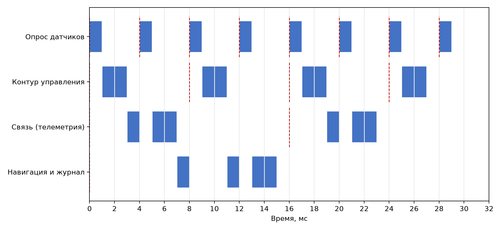

# Планирование периодических задач: RMS и EDF


Практическая работа №3 по системам реального времени. Консольная программа на Python проверяет **планируемость набора периодических задач** методами Rate Monotonic (RMS) и Earliest Deadline First (EDF) и строит диаграмму выполнения.

**Вариант:** бортовая система (управление, датчики, связь).

**Автор:** Марченко И.Р.
## Возможности

- чтение набора задач τ = (C, T, D) из файла JSON или CSV;
- коэффициент загрузки U = Σ C<sub>i</sub>/T<sub>i</sub>;
- RMS: утилизационный тест Liu & Layland с границей n(2<sup>1/n</sup> − 1);
- RMS: анализ времени отклика каждой задачи по рекуррентной формуле;
- EDF: проверка условия U ≤ 1 (для неявных дедлайнов);
- диаграмма выполнения по RMS на интервале [0, гиперпериод] в консоли и в PNG.

Приоритеты RMS назначаются автоматически по периоду: чем меньше период, тем выше приоритет.

## Структура проекта

```
.
├── src/
│   └── main.py          # исходный код программы
├── data/
│   ├── variant.json     # набор задач варианта (JSON)
│   └── variant.csv      # тот же набор (CSV)
├── docs/
│   ├── Отчет_ЛР3_RMS_EDF.docx   # отчёт
│   ├── gantt.png        # диаграмма выполнения
│   └── output.txt       # пример вывода программы
├── requirements.txt
└── README.md
```

## Требования

- Python 3.10 или новее;
- для расчётов и текстовой диаграммы дополнительные библиотеки не нужны;
- для сохранения диаграммы в PNG (ключ `--png`) нужен [matplotlib](https://matplotlib.org/).

## Запуск

```bash
python src/main.py -i data/variant.json
python src/main.py -i data/variant.csv
```

Сохранение диаграммы в PNG:

```bash
pip install -r requirements.txt
python src/main.py -i data/variant.json --png docs/gantt.png
```

| Ключ | Описание |
|---|---|
| `-i`, `--input` | путь к файлу с задачами (`.json` или `.csv`), обязательный |
| `--png` | путь для сохранения диаграммы выполнения в PNG, необязательный |

## Формат входных данных

Время задаётся в миллисекундах: `C` — время выполнения, `T` — период, `D` — относительный дедлайн.

**JSON**

```json
{
  "tasks": [
    {"name": "Опрос датчиков", "C": 1, "T": 4, "D": 4},
    {"name": "Контур управления", "C": 2, "T": 8, "D": 8}
  ]
}
```

**CSV**

```csv
name,C,T,D
Опрос датчиков,1,4,4
Контур управления,2,8,8
```

## Набор задач варианта

| № | Задача | C, мс | T, мс | D, мс |
|---|---|---|---|---|
| 1 | Опрос датчиков | 1 | 4 | 4 |
| 2 | Контур управления | 2 | 8 | 8 |
| 3 | Связь (телеметрия) | 3 | 16 | 16 |
| 4 | Навигация и журнал | 4 | 32 | 32 |

## Результаты

| Задача | C | T | D | R | Уложилась |
|---|---|---|---|---|---|
| Опрос датчиков | 1 | 4 | 4 | 1 | да |
| Контур управления | 2 | 8 | 8 | 3 | да |
| Связь (телеметрия) | 3 | 16 | 16 | 7 | да |
| Навигация и журнал | 4 | 32 | 32 | 15 | да |

- **Загрузка:** U = 0,8125.
- **RMS, тест Liu & Layland:** граница для n = 4 равна 0,7568, U выше границы, тест **не пройден**. Это лишь достаточное условие, поэтому вывод делается по времени отклика.
- **RMS, время отклика:** все задачи укладываются в дедлайны, набор **планируем**.
- **EDF:** U ≤ 1, набор **планируем**.

### Диаграмма выполнения (RMS, гиперпериод 32 мс)



Синие блоки — выполнение задачи, красные штриховые линии — моменты активации.

<details>
<summary>Пример вывода программы</summary>

```text
Задача             | C | T  | D  | R  | Уложилась
-------------------+---+----+----+----+----------
Опрос датчиков     | 1 | 4  | 4  | 1  | да       
Контур управления  | 2 | 8  | 8  | 3  | да       
Связь (телеметрия) | 3 | 16 | 16 | 7  | да       
Навигация и журнал | 4 | 32 | 32 | 15 | да       

Загрузка: U = 0.8125
RMS (Liu & Layland): граница n=4: 0.7568; U > 0.7568 -> тест не пройден (достаточное условие не выполнено)
RMS (время отклика): все задачи укладываются в дедлайны
EDF: U <= 1 -> набор планируем

Диаграмма выполнения по RMS на [0, 32] (гиперпериод = 32 мс), █ — выполнение, | — активация:
                     0         1         2         3 
                     01234567890123456789012345678901
Опрос датчиков     | █···█···█···█···█···█···█···█···
Контур управления  | |██·····|██·····|██·····|██·····
Связь (телеметрия) | |··█·██·········|··█·██·········
Навигация и журнал | |······█···█·██·················
Простой            | ···············█·······█···█·███
```

</details>

## Как это работает

**Время отклика.** Для задачи τ<sub>i</sub> итерация начинается с R⁽⁰⁾ = C<sub>i</sub> и продолжается по формуле

R⁽ᵏ⁺¹⁾ = C<sub>i</sub> + Σ ⌈R⁽ᵏ⁾ / T<sub>j</sub>⌉ · C<sub>j</sub>, где сумма берётся по задачам j с более высоким приоритетом.

Итерация останавливается, когда R⁽ᵏ⁺¹⁾ = R⁽ᵏ⁾ (найдено время отклика) или когда R⁽ᵏ⁺¹⁾ > D (задача не укладывается в дедлайн).

**Основные функции** (`src/main.py`):

| Функция | Назначение |
|---|---|
| `utilization(tasks)` | коэффициент загрузки U |
| `liu_layland_bound(n)` | граница Liu & Layland |
| `rms_schedulable(tasks)` | утилизационный тест RMS |
| `edf_schedulable(tasks)` | проверка планируемости по EDF |
| `response_time(task, higher)` | время отклика задачи |
| `gantt(tasks, interval)` | текстовая диаграмма выполнения |
| `by_priority(tasks)` | приоритеты RMS (сортировка по периоду) |
| `hyperperiod(tasks)` | гиперпериод — НОК периодов |
| `load_tasks(path)` | чтение и проверка данных из JSON или CSV |

Задача описывается через `@dataclass` `Task(name, C, T, D)`.

## Отчёт

Полный отчёт с теорией, описанием алгоритма и результатами: [docs/Отчет_ЛР_3_RMS_EDF.docx](docs/Отчет_ЛР_3_RMS_EDF.docx).
